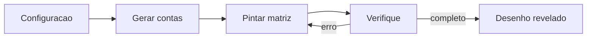

# Matriz Matemática

Plano implementado. Para abrir o jogo: `npm run dev` e acesse http://localhost:5173.

Jogo educativo de uma página, em português, para abrir no navegador (tablet ou computador da sala). Sem login e sem servidor: Vite + React + TypeScript.

A conta fica **dentro da célula**. A paleta à direita associa **uma cor a um resultado**. O aluno pinta a célula com a cor do resultado certo. Quando acerta tudo, as contas somem e o desenho aparece.

Referências de mecânica:

- https://www.digipuzzle.net/minigames/mozaics/mozaics_multiplications.htm?language=portuguese
- https://www.digipuzzle.net/minigames/mozaics/mozaics_zero_to_ten.htm?language=portuguese

## O que dá para escolher

Engrenagem abre um painel. A escolha fica salva no navegador.

- Operação: **Soma** ou **Multiplicação**
- Soma: **até 10** ou **até 20** (parcelas de 0 até o limite, soma dentro do limite, inclusive 0)
- Multiplicação: tabuadas de **1 a 10**, uma ou várias. A conta usa a tabuada escolhida como primeiro fator (`3×1` … `3×10`). Se duas tabuadas estão ativas, `3×4` e `4×3` podem aparecer e, se o produto for o mesmo, compartilham a cor
- Desenho e tamanho juntos: cada tema existe em **8×8**, **12×10** e **16×12**. A prévia mostra o mosaico nas cores reais do tema
- Só biblioteca pronta. Sem editor para o professor desenhar

## Biblioteca de desenhos

Oito temas, cada um desenhado nas três grades (24 mosaicos), com 4 a 6 cores fixas para o desenho continuar reconhecível:

- Dinossauro, astronauta, caminhão, carro, unicórnio
- Bichinhos: gato, peixe e coelho

Cada mosaico é uma grade de letras num arquivo de dados, por exemplo `src/game/pictures/dino.ts`. As cores do desenho não mudam; o que muda a cada partida é **qual resultado corresponde a cada cor**.

## Como a partida é montada

Em `src/game/generate.ts`:

- Junta as contas válidas e agrupa por resultado
- Uma tabuada sozinha já tem 10 produtos distintos; os desenhos usam no máximo 6 cores, então a paleta sempre cabe
- Atribui um resultado diferente a cada cor. Regiões grandes (fundo) recebem resultados com mais jeitos de decompor, para não repetir a mesma conta o tempo todo
- Em cada célula, sorteia uma conta daquele resultado, alternando as variações (`3+2` e `2+3`, etc.)

## Ábaco (somente na soma)

Barra no estilo rekenrek, abaixo da matriz:

- Até 10: uma haste com 10 contas (5 + 5)
- Até 20: duas hastes com 10 contas
- Arrastar uma conta para a esquerda leva junto as contas do meio, como no ábaco de verdade; um toque também move
- A célula selecionada mostra a pergunta em cima do ábaco (`Quanto é 4 + 3?`)
- O total de contas à esquerda aparece para o aluno ligar a quantidade ao número da paleta
- Botão para esvaziar. O ábaco não preenche a célula sozinho

## Conferir e recomeçar

- Célula vazia ou com a cor errada é marcada, e o aluno corrige
- Tudo certo: as contas somem, o mosaico fica limpo e surge uma mensagem curta (`Você completou o dinossauro!`)
- "Nova partida" mantém tema, tamanho e operação, e sorteia outras contas

## Interface

Grade grande, alvos fáceis de tocar, paleta com a **cor e o número**, borracha para limpar uma célula. Em tela estreita, a paleta passa para baixo da grade. Visual próprio, sem a marca do site de referência.

Arquivos principais:

- `src/App.tsx` — estado da partida
- `src/components/Board.tsx` — matriz
- `src/components/Palette.tsx` — cores e Verifique
- `src/components/Abacus.tsx` — contas arrastáveis
- `src/components/SettingsDialog.tsx` — tema, tamanho, operação
- `src/game/problems.ts` e `src/game/generate.ts`
- `src/game/pictures/` — os 24 mosaicos

No fim, abrir o jogo no navegador e percorrer soma até 10 (com ábaco), soma até 20 e uma multiplicação de tabuadas escolhidas, inclusive o botão Verifique com erro e com acerto.

## Ordem de implementação

1. Criar o app Vite + React + TypeScript e o estado da partida
2. Gerar contas de soma (até 10 e até 20) e de tabuadas, mapeando um resultado por cor
3. Desenhar os 8 temas em 8×8, 12×10 e 16×12
4. Montar grade, paleta, borracha, Verifique e tela de mosaico completo
5. Ábaco arrastável abaixo da matriz, só na soma, com 1 ou 2 hastes
6. Painel para operação, limite ou tabuadas, tema e tamanho, salvo no navegador
7. Testar no navegador soma, ábaco, multiplicação e conferência
